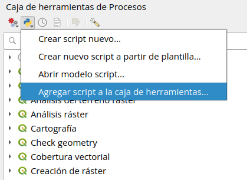

## **Herramientas QGIS para monitoreo forestal**

*Scripts de Procesos para la enseñanza de Dasometría y SIG aplicado a
Ecología*

### **Descripción**

Este repositorio reúne herramientas complementarias para QGIS que uso en
el dictado de clases de Dasometría (medición forestal) y en cursos de
capacitación de SIG aplicados a Ecología. Cada herramienta se instala en
la Caja de herramientas de Procesos y se utiliza desde un formulario,
sin necesidad de escribir código.

Las herramientas fueron pensadas para el trabajo en clase, pero pueden
usarse libremente en proyectos de investigación o monitoreo.

*Actualizado: Octubre 2026*

------------------------------------------------------------------------

### **Modo de uso**

1.  **Descargar el script.** Guardar el archivo `.py` en tu computadora.
2.  **Agregarlo a QGIS.** Abrí la Caja de herramientas de Procesos
    (*Procesos → Caja de herramientas*), hacé clic en el ícono de Python
    de la barra superior y elegí *Añadir script a la caja de
    herramientas…*. Seleccioná el archivo descargado.

3.  **Usarlo.** La herramienta aparece en *Scripts*, dentro del grupo
    *RGM Forest Tools*.

------------------------------------------------------------------------

## Herramientas

### Grilla de muestreo sistemática con arranque aleatorio

Genera una grilla regular de parcelas (puntos) dentro de un área de
estudio, con el punto de arranque sorteado al azar dentro de una celda.
Cada ejecución produce una grilla en otra posición, pero conserva la
equidistancia entre parcelas.

📥 [Descargar
`grilla_sistematica_aleatoria.py`](scripts/grilla_sistematica_aleatoria.py)
